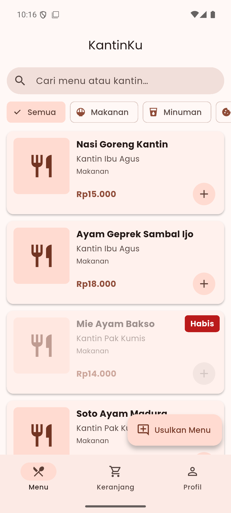
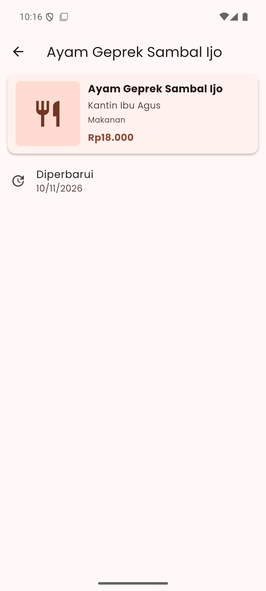
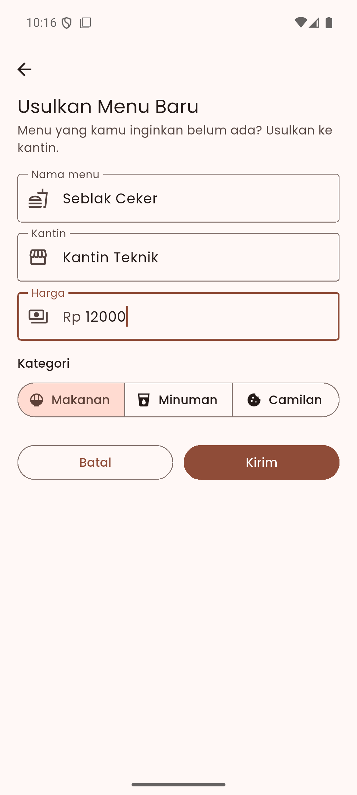
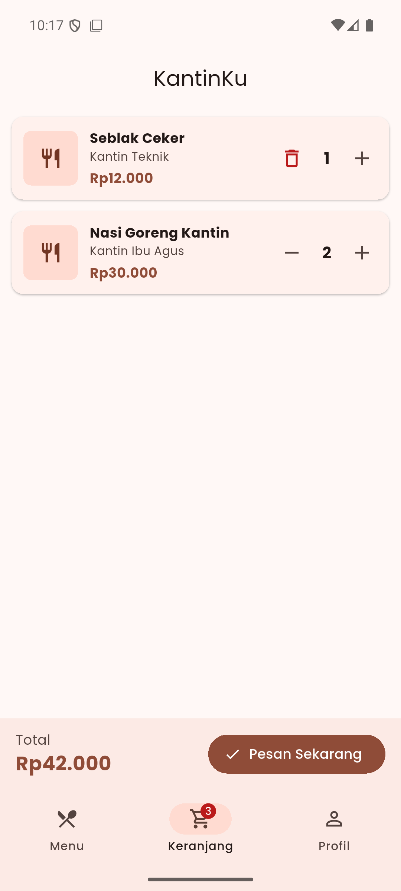
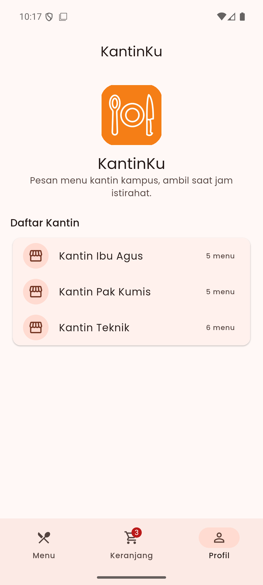
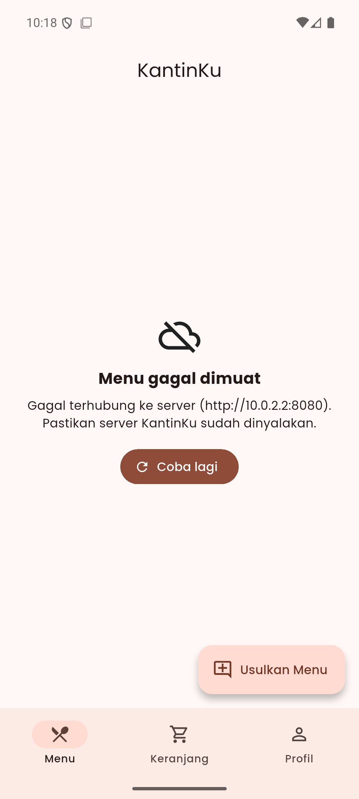
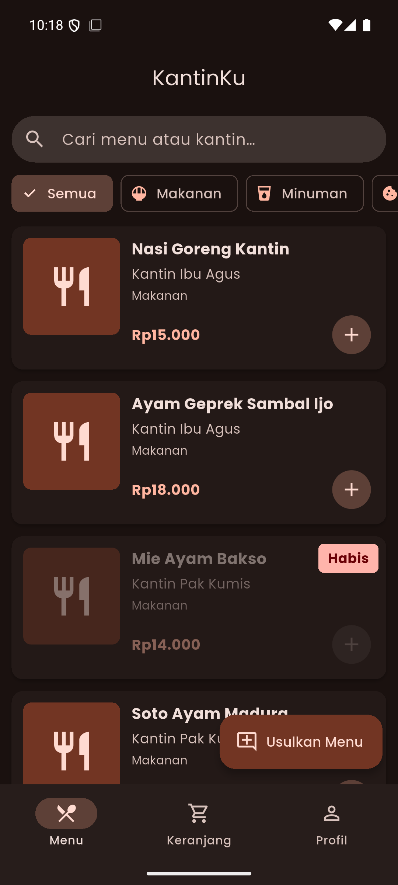

# KantinKu

Aplikasi Flutter untuk melihat menu dari beberapa kantin kampus, lalu menyusun pesanan (pre-order) untuk diambil saat jam istirahat. Dilengkapi server REST API kecil berbasis Dart (`shelf` + `shelf_router`).

UTS Pengembangan Aplikasi Bergerak, Pertemuan 8.

## Kelompok

**Kelompok 02**, Proyek 1: *KantinKu, menu kantin dan pre-order*

| Nama | NIM | Tugas |
|---|---|---|
| Fauziah Adinda Putri Ilham | 102022300248 | Setup proyek dan repositori; P01–P02 (nama aplikasi); P06: tema terang/gelap, font Poppins, ikon launcher, aset gambar; rancangan awal server |
| Kenneth Bryan | 102022330093 | P03: pencarian, filter kategori, keranjang, form usulan, SnackBar. Revisi UTS: server final + POST, integrasi P07 ke server, pull-to-refresh, warna dari `colorScheme`, tab Profil, README |
| Ghilman Arba | 102022300435 | P04: model `Menu`, kartu menu, layout, NavigationBar |
| Naufal Dzaki Akhdani Mohy | 102022300381 | P05: halaman detail, form tambah sebagai halaman, animasi Hero, widget test |
| Abdullah Muchtar Rasyid | *(isi NIM)* | P07: layanan HTTP, FutureBuilder 3 keadaan, test MockClient |

## Struktur

```
KantinKu/                      # proyek Flutter (root repo)
├── lib/                       # kode aplikasi
├── test/                      # widget test + unit test MockClient
├── assets/                    # logo (images/), ikon launcher (icon/), font Poppins (fonts/)
├── pubspec.yaml
├── server/                    # API Dart (shelf + shelf_router)
│   ├── bin/server.dart        # titik masuk server
│   ├── lib/kantinku_api.dart  # router dan endpoint
│   ├── data/kantinku.json     # 15 menu awal dari 3 kantin
│   └── test/                  # test endpoint server
├── screenshots/               # tangkapan layar dari perangkat
└── README.md
```

## Cara menjalankan

### 1. Nyalakan server

```bash
cd server
dart pub get
dart run bin/server.dart
```

Server berjalan di `http://localhost:8080`. Port bisa diganti dengan variabel lingkungan `PORT`. Data disimpan di memori, jadi menu yang ditambah lewat aplikasi hilang saat server dimatikan.

| Method | Endpoint | Isi |
|---|---|---|
| GET | `/menu` | Daftar semua menu |
| GET | `/menu/<id>` | Satu menu berdasarkan id (404 jika tidak ada) |
| GET | `/kantin` | **Endpoint khas:** daftar kantin beserta jumlah menunya |
| POST | `/menu` | Menyimpan usulan menu baru (nilai tambah) |

Cek cepat: `curl http://localhost:8080/kantin`

### 2. Jalankan aplikasi

Buka terminal baru di root repo:

```bash
flutter pub get

# Emulator Android (10.0.2.2 = komputer dilihat dari emulator)
flutter run --dart-define=API_URL=http://10.0.2.2:8080

# HP Android fisik: pakai IP laptop di Wi-Fi yang sama, mis. 192.168.1.10
flutter run --dart-define=API_URL=http://192.168.1.10:8080

# Windows / Chrome
flutter run -d windows --dart-define=API_URL=http://localhost:8080
```

Tanpa `--dart-define`, aplikasi memakai `http://10.0.2.2:8080`.

### 3. Test

```bash
flutter analyze        # bersih, tanpa error maupun warning
flutter test           # 17 test aplikasi (10 widget test + 7 unit test MockClient)
cd server && dart test # 4 test endpoint server
```

### APK debug

```bash
flutter build apk --debug --dart-define=API_URL=http://10.0.2.2:8080
```

Alamat API ikut tertanam di APK, jadi sesuaikan `API_URL` dengan perangkat yang dipakai.

## Tangkapan layar

Diambil dari emulator Android (sdk gphone64, Android 16) dengan server KantinKu menyala.

| Menu | Detail | Form tambah | Keranjang |
|---|---|---|---|
|  |  |  |  |
| Daftar dari `GET /menu`, filter ChoiceChip, label "Habis" | Halaman detail (Hero) | Form usulan menu | Tambah/kurang jumlah, total otomatis |

| Profil | Server mati | Mode gelap |
|---|---|---|
|  |  |  |
| Logo aset + daftar dari `GET /kantin` | Keadaan gagal dengan tombol Coba lagi | `darkTheme` (tombol 🌙/☀️ di AppBar) |

## Tabel pemenuhan fitur

### P01 & P02: Proyek dan aplikasi pertama

| Poin | File:baris | Keterangan |
|---|---|---|
| `--org id.ac.telkomuniversity`, bukan `com.example` | android/app/build.gradle.kts:19 | `id.ac.telkomuniversity.kantinku` |
| Nama di launcher sesuai tema | android/app/src/main/AndroidManifest.xml:5 | `KantinKu` |
| Berjalan di emulator/HP, min. 4 tangkapan layar | screenshots/ | 7 tangkapan layar dari emulator Android 16 |
| `flutter analyze` bersih | - | `No issues found!` |

### P03: Widget dasar, input, dan interaksi

| Poin | File:baris | Keterangan |
|---|---|---|
| StatelessWidget buatan sendiri | lib/filter_kategori.dart:7 | `FilterKategori` (juga `KartuMenu`, `ItemKeranjang`) |
| StatefulWidget + `setState` | lib/halaman_menu.dart:10, lib/halaman_menu.dart:49 | `HalamanMenu`, ganti kategori dengan `setState` |
| TextField + TextEditingController yang di-dispose | lib/halaman_menu.dart:29, lib/halaman_menu.dart:41 | Kolom cari, `dispose()` di `dispose` |
| Min. 2 jenis tombol Material 3 | lib/form_usulan.dart:180, lib/form_usulan.dart:187, lib/halaman_utama.dart:252 | `OutlinedButton`, `FilledButton`, `FloatingActionButton.extended`, `IconButton` |
| ChoiceChip / SegmentedButton | lib/filter_kategori.dart:34, lib/form_usulan.dart:150 | ChoiceChip kategori, SegmentedButton di form |
| SnackBar | lib/halaman_utama.dart:102 | Tambah ke keranjang, hapus (Urungkan), kirim usulan |

### P04: Model, layout, dan navigasi bawah

| Poin | File:baris | Keterangan |
|---|---|---|
| Model min. 6 field, ada DateTime dan bool | lib/model_menu.dart:1 | `Menu`: 8 field, `diperbarui` (DateTime), `tersedia` (bool) |
| Widget kartu dengan Row, Column, Expanded, Stack | lib/kartu_menu.dart:67 | `KartuMenu`: Stack (67), Row (73), Expanded (91), Column (92) |
| ListView.builder | lib/halaman_menu.dart:127 | Daftar menu |
| NavigationBar min. 3 tab + IndexedStack | lib/halaman_utama.dart:258, lib/halaman_utama.dart:233 | Tab Menu, Keranjang, Profil |

### P05: Banyak halaman, async, debugging, dan test

| Poin | File:baris | Keterangan |
|---|---|---|
| Halaman detail menerima model lewat konstruktor | lib/halaman_menu.dart:139, lib/halaman_detail_menu.dart:7 | `Navigator.push` ke `HalamanDetailMenu(menu: menu)` |
| Form tambah mengembalikan data dengan `Navigator.pop(context, data)` | lib/form_usulan.dart:78 | `Navigator.pop(context, usulan)` |
| Data diterima dengan `await` dan langsung muncul di daftar | lib/halaman_utama.dart:177, lib/halaman_utama.dart:191 | `await Navigator.push`, lalu `_menuUsulan.insert(0, usulan)` |
| Cek `mounted` setelah `await` | lib/halaman_utama.dart:188 | `if (usulan == null \|\| !mounted) return;` |
| Min. 3 widget test, `flutter test` lulus | test/widget_test.dart | 10 widget test, semua lulus |

### P06: Tema, font, dan ikon

| Poin | File:baris | Keterangan |
|---|---|---|
| `ColorScheme.fromSeed` + `darkTheme` | lib/theme.dart:18, lib/theme.dart:23, lib/main.dart:38 | Seed oranye kantin; awalnya ikut sistem, bisa diganti lewat tombol 🌙/☀️ di AppBar (lib/halaman_utama.dart:83) |
| Warna dari `Theme.of(context).colorScheme` | lib/kartu_menu.dart:56 | Tidak ada `Colors.xxx` di widget; satu-satunya hanya warna seed di lib/theme.dart:11 |
| Font kustom | pubspec.yaml:33, lib/theme.dart:16 | Poppins, file font di `assets/fonts/` (lisensi OFL) |
| Ikon launcher sendiri (`flutter_launcher_icons`) | pubspec.yaml:19, android/app/src/main/AndroidManifest.xml:8 | Dari `assets/icon/app_icon.png` |
| Gambar aset lokal terdaftar di pubspec.yaml | pubspec.yaml:29, lib/halaman_profil.dart:67 | `assets/images/logo.png`, tampil di tab Profil |

### P07: Web service, HTTP, dan JSON

| Poin | File:baris | Keterangan |
|---|---|---|
| Folder `server/` dengan shelf + shelf_router, min. 12 item JSON | server/bin/server.dart:24, server/data/kantinku.json | 15 menu dari 3 kantin |
| GET daftar item | server/lib/kantinku_api.dart:34 | `GET /menu` |
| GET satu item berdasarkan id | server/lib/kantinku_api.dart:37 | `GET /menu/<id>` |
| GET endpoint khas tema | server/lib/kantinku_api.dart:46 | `GET /kantin`: daftar kantin dan jumlah menunya |
| Paket `http` + `--dart-define=API_URL` | lib/layanan_menu.dart:4, lib/layanan_menu.dart:23 | `String.fromEnvironment('API_URL')` |
| `fromJson` / `toJson` dengan konversi DateTime | lib/model_menu.dart:22, lib/model_menu.dart:35 | `DateTime.parse` dan `toIso8601String` |
| FutureBuilder dengan 3 keadaan | lib/halaman_utama.dart:284 | Memuat (290), gagal + tombol Coba lagi (305, 331), berhasil |
| Test dengan MockClient | test/layanan_menu_test.dart:13, test/helper_mock.dart:50 | 7 unit test `LayananMenu` tanpa server sungguhan |

### Fitur khas KantinKu (Bagian 5)

| Poin | File:baris | Keterangan |
|---|---|---|
| Filter kategori dengan ChoiceChip | lib/filter_kategori.dart:34 | Semua, Makanan, Minuman, Camilan |
| Tombol tambah/kurang di keranjang, total otomatis | lib/halaman_utama.dart:134, lib/halaman_utama.dart:140, lib/halaman_keranjang.dart:27 | Total dihitung ulang setiap jumlah berubah |
| Menu `tersedia == false` pudar + label "Habis" (Stack) | lib/kartu_menu.dart:70, lib/kartu_menu.dart:168 | `Opacity` 0.45 dan label `Positioned` |
| Endpoint `GET /kantin` | server/lib/kantinku_api.dart:46, lib/halaman_profil.dart:30 | Ditampilkan di tab Profil |

### Nilai tambah

| Poin | File:baris | Keterangan |
|---|---|---|
| Form tambah dikirim ke server dengan POST | lib/layanan_menu.dart:66, server/lib/kantinku_api.dart:60 | `POST /menu`. Jika server mati, usulan tetap tampil di aplikasi |
| Pull-to-refresh | lib/halaman_menu.dart:125, lib/halaman_utama.dart:56 | `RefreshIndicator`; daftar lama tetap tampil selama memuat |
| Animasi Hero kartu ke detail | lib/kartu_menu.dart:77 | Tag `menu-<id>`, gambar berpindah ke halaman detail |
